<picture>
  <source media="(prefers-color-scheme: dark)" srcset="./dark.svg">
  <source media="(prefers-color-scheme: light)" srcset="./light.svg">
  
</picture>

[Portfolio](https://darshan-u-18.github.io/Darshan-Portfolio/) · [GitHub](https://github.com/Darshan-U-18) · [LinkedIn](https://www.linkedin.com/in/darshan-u-b73058346/) · [LeetCode](https://leetcode.com/u/Darshan-U/)

